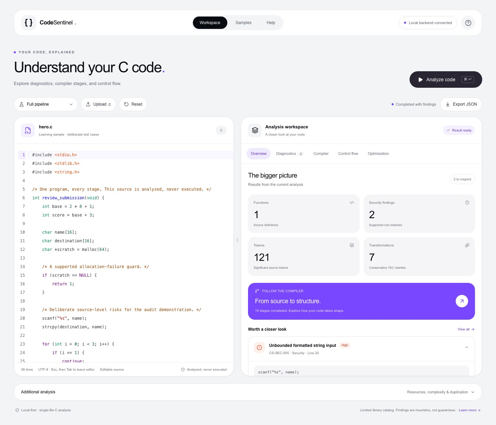
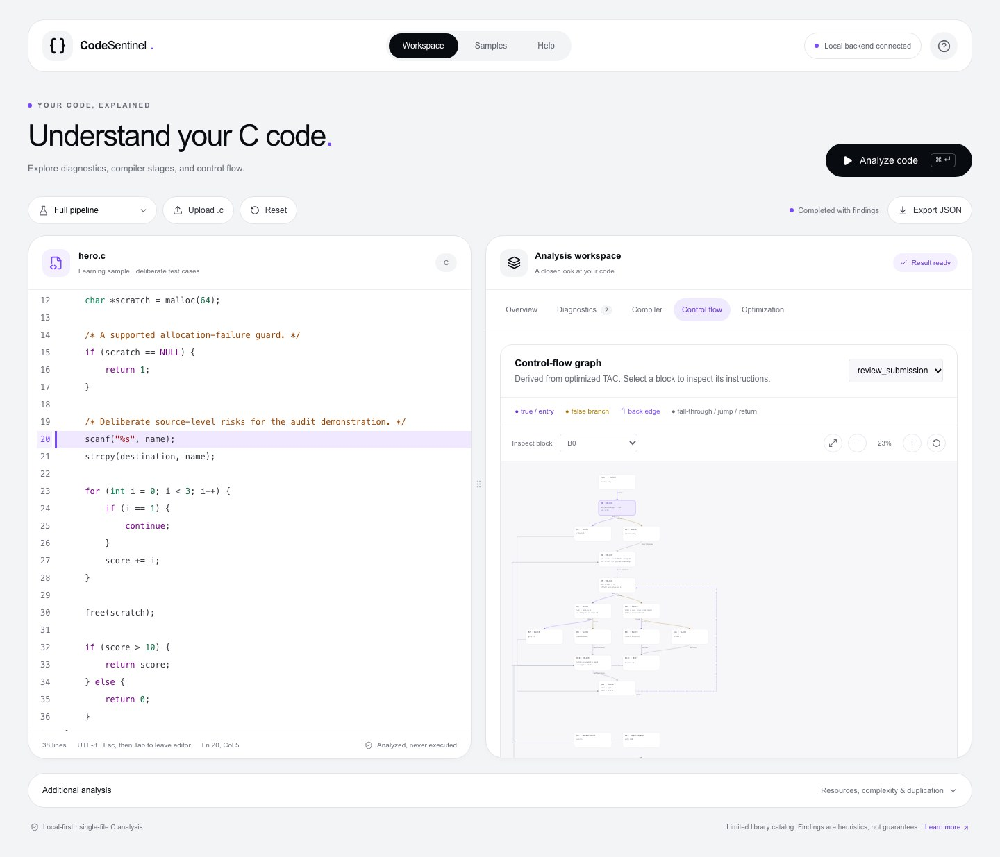
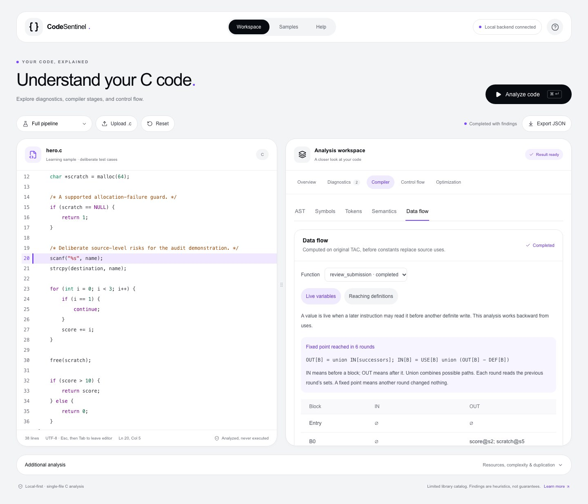

# CodeSentinel C analysis workbench

CodeSentinel is a local Compiler Design Laboratory workbench. One C source file travels through a real ANTLR parser, Java analysis passes, and a React dashboard. Every displayed output is generated from the submitted program. The program is never executed or compiled into a binary.

The teaching journey is **source → tokens → AST → scoped symbols → findings → TAC → optimized TAC → CFG → scalar data flow → dashboard → JSON**.

## Run the workbench

Prerequisites: **JDK 21**, Node.js 20.19+ or 22.12+ (tested with 24.13.1), npm, and internet access for the first dependency installation. Maven 3.9.14 is downloaded by the included wrapper; a global Maven installation is unnecessary. The POSIX scripts work on macOS/Linux. On macOS they explicitly select JDK 21 using `java_home`; elsewhere set `JAVA_HOME` to JDK 21.

From this directory:

```bash
./scripts/setup.sh
./scripts/start.sh
```

Open **http://127.0.0.1:5173**. The backend listens at **http://127.0.0.1:8080**. `start.sh` serves the built frontend and packaged Java application; Ctrl+C stops both. Ports must be available. Initial setup also installs Chromium for browser tests. After setup, normal startup needs no network access.

For development, use two terminals:

```bash
# Terminal 1, project root
./scripts/backend.sh

# Terminal 2, project root
cd frontend
npm run dev
```

The Vite proxy forwards `/api` to the Java server. Changes to Java require restarting `backend.sh`; frontend development uses Vite hot reload. After editing, stop the packaged demo before rebuilding, then restart with `start.sh`. A running JVM must keep its jar unchanged. Setup/full verification enforce this with a port check. Browser-only tests can reuse the running demo.

## Implemented features

- A light workbench using the supplied gray/white/black/violet palette, pill navigation, rounded cards, and a resizable editor/results split.
- A CodeMirror editor with syntax highlighting, line numbers, undo/redo, matching brackets, and highlighted source locations.
- Real tokens, comments, located syntax errors, and a simplified expandable AST.
- An educational symbol table with global/function/block/for scopes, parameters, shadowing, and resolved references.
- Selected declaration, prototype, undeclared-use, return-presence, and explicit-return-path checks.
- Structured TAC for the supported subset, short-circuit branches, and correct loop break/continue targets.
- Checked signed 32-bit constant folding and conservative block-local constant propagation, with source-linked rewrite explanations.
- Selectable SVG basic blocks arranged by control-flow depth, labelled edges, unreachable markers, fit/zoom/pan, keyboard inspection, and predecessor/successor navigation, derived from optimized TAC.
- Typed TAC operands, AST node IDs, and explicit read/write/call/volatile/trap effects; AST source connections link tokens, resolved symbols, instructions, and CFG blocks.
- Live-variable and reaching-definitions fixed points on original TAC, with block facts, source-linked definitions, iteration traces, and explicit per-function limits.
- AST-based unsafe-library-call rules, limited command provenance, and credential-name heuristics.
- Allocation call-site analysis, local guard/release hints, static structure metrics, and function-body fingerprints.
- Backend heuristic review-priority contributions in exported JSON; resources, complexity, and duplication under Additional analysis.
- Sample selection, category/search filters, source navigation, unavailable states, stale-result protection, and suspected-credential redaction in analysis responses.
- Bounded table rendering (100 rows per page), request timeouts and unreadable-response recovery, arrow-key tab navigation, visible focus, and reduced-motion support.

Memory-value data flow, DCE, CSE, full C type checking, preprocessing, general alias/taint/path analysis, and interprocedural analysis remain deferred. Their coverage is stated in the response/UI. There are no accounts, database, history, or hosted deployment.

## Stack and source map

| Area | Version or implementation |
|---|---|
| Java API | Java 21, Spring Boot 3.5.16, Jackson, Maven Wrapper 3.9.14 |
| Parser | ANTLR generator/plugin/runtime 4.13.2, pinned grammars-v4 snapshot |
| UI | React 19.3.0, JavaScript/JSX, Vite 8.3.4 |
| Visuals | Tailwind utilities, Recharts, custom SVG CFG, Lucide icons |
| Documentation view | react-markdown 10.1.0, remark-gfm 4.0.1 |
| Verification | JUnit 5, Spring MockMvc, Playwright Chromium against Java |

`backend/src/main/java/com/codesentinel/parser` isolates parser integration. `analysis` contains the application algorithms; `model` contains AST/instruction/source records. `frontend/src` contains the workbench. `samples` contains C fixtures. `docs` explains the implementation. Dependencies are resolved in `frontend/package-lock.json` and the versioned Maven POM/wrapper configuration.

The interface uses light gray (`#F3F4F6`), white, near-black (`#080B10`), and violet (`#7947FF`), with orange/yellow diagnostic accents. Editor and results remain side by side on desktop; drag the divider or use its arrow keys to resize. Smaller screens stack the panels and let the result tabs scroll. Compiler views and charts load on demand. Shared presentation utilities live in `frontend/src/ui.jsx`; Tailwind supplies layout styling, and the CodeMirror theme is defined inline in `editor.jsx`.

Results tabs are Overview, Diagnostics, Compiler, Control flow, and Optimization. Compiler contains AST, Symbols, Tokens, Semantics, and Data flow. Help explains the local setup and analysis boundary; Samples opens the learning fixtures. Source edits mark results stale and disable source navigation and export until reanalysis.

## API and input boundary

Only these endpoints are implemented:

| Endpoint | Result |
|---|---|
| `GET /api/health` | Application, ANTLR, grammar commit, and Java identity |
| `GET /api/samples` | C fixtures with teaching purposes |
| `POST /api/analyze` | One complete analysis; JSON body contains `source` and optional display `filename` |

Completed analysis requests return `{success:true,data:...}`, including syntax errors as structured analysis results. Malformed/blank requests return 400; source larger than 64 KiB returns 413; wrong methods/media types return 405/415; unexpected failures return a safe 500. Defaults also limit significant tokens to 10,000 and delimiter nesting to 128, grammar-tree depth to 512, and AST depth to 128. Source ranges use one-based lines/columns and UTF-16 offsets compatible with the editor.

This release targets single-file lab programs. Four headers (`stdio.h`, `stdlib.h`, `string.h`, `stddef.h`) use a limited catalog. Headers are never read or expanded. Macros, conditional preprocessing, and other headers withhold downstream analysis. Unsupported statements/declarators are disclosed; a function with unsupported TAC is skipped, while other passes can report their own assessed coverage.

Export downloads the existing JSON response, excluding raw source. Editing marks results stale and disables export/source navigation until reanalysis. The credential detector is a name/literal heuristic: it redacts suspected values throughout projected artifacts, while the editor retains the original input.

## Verify

```bash
./scripts/test.sh
```

This runs backend verification, a frontend production build, and real-backend browser tests. Stop CodeSentinel services first: setup/full verification checks the ports before replacing build artifacts. Playwright starts the servers automatically. For a clean managed test run, use:

```bash
CI=1 ./scripts/test.sh
```

Individual commands:

```bash
source scripts/java21.sh
(cd backend && ./mvnw -B verify)
(cd frontend && npm run build)
(cd frontend && npm run test:e2e)
```

Tests validate expected structured results; they never run the C fixtures or generated programs. See [verification evidence](docs/VERIFICATION.md) for the completed checks and boundaries.

## Samples and three-minute demonstration

| Sample | Teaching purpose |
|---|---|
| `hero.c` | 37-line complete journey, input/string-copy warnings, loop/branch, checked allocation/free |
| `arithmetic.c` | Both optimization passes; final `return 20` |
| `scopes.c` | Compatible prototype, nested shadowing, resolved symbols |
| `strings.c` / `bounded.c` | Unbounded input/command provenance versus bounded input |
| `secrets.c` | A fake placeholder matching the credential-name heuristic |
| `loops.c` | Nested loops, continue, complexity |
| `resources.c` | Matched/unguarded/loop/escaped allocation patterns |
| `duplicates.c` | Exact and identifier-renaming body matches |
| `syntax-error.c` | Located diagnostic and recovery |
| `unsupported.c` / `macros.c` | Partial downstream coverage and preprocessing boundary |

1. Analyze the default **Full pipeline** sample.
2. Open Compiler: tokens, AST, symbols, and resolved references.
3. Open Diagnostics → Security, inspect a finding, and follow its source link.
4. Open Optimization and compare original/optimized TAC and the folding/propagation explanations.
5. Open Control flow, select a CFG block, and explain a branch and loop back edge. Use Fit graph for an overview.
6. Open Compiler → Data flow and show a converged fixed point and the final unchanged round.
7. Expand Additional analysis to show the checked allocation, then export JSON.

Use [the viva guide](docs/VIVA_GUIDE.md) for timing, worked examples, questions, and syntax-error recovery. The `demo` directory contains actual 1440px desktop, 768px tablet, and 390px mobile captures from this UI revision. Recreate them with `(cd frontend && node scripts/capture-review.mjs)` while the packaged demo is running. An optional recording script is available as `(cd frontend && npm run demo:record)` while the app runs; no video recording is included by default.

## Documentation

- [Simple English product guide](docs/PRODUCT_GUIDE.md)
- [Shareable Word guide](docs/CodeSentinel_Product_Guide.docx)
- [Code review and fixes](docs/CODE_REVIEW.md)

- [Architecture](docs/ARCHITECTURE.md)
- [Compiler concepts and implementing methods](docs/COMPILER_CONCEPTS.md)
- [Parser walkthrough](docs/PARSER_WALKTHROUGH.md)
- [Security and other rules](docs/SECURITY_RULES.md)
- [Analysis limitations](docs/ANALYSIS_LIMITATIONS.md)
- [Faculty demonstration guide](docs/FACULTY_GUIDE.md)
- [Data flow explained](docs/DATA_FLOW.md)
- [Viva guide](docs/VIVA_GUIDE.md)
- [Third-party provenance and adaptations](docs/THIRD_PARTY.md)

CodeSentinel is an educational static analyzer. Warnings are review evidence, complexity is a source metric, and a score of zero means no scored findings in the assessed scope.

## Actual interface captures

These images were captured from the built React app against the local Java backend using the bundled teaching sample.







[Tablet compiler view](demo/tablet-compiler.jpg) · [Mobile overview](demo/mobile-overview.jpg) · [Optimization](demo/desktop-optimization.jpg)

Schema **1.1** keeps the existing response fields and adds instruction operand/effect metadata and computed `dataFlow` results. Data flow analyzes the original instruction stream; the displayed CFG remains based on optimized TAC. Their instruction/block boundaries are preserved by the current two optimization passes. Unknown incoming values and possible call/store writes are labeled, and incomplete fixed points are withheld. See [data flow explained](docs/DATA_FLOW.md).
